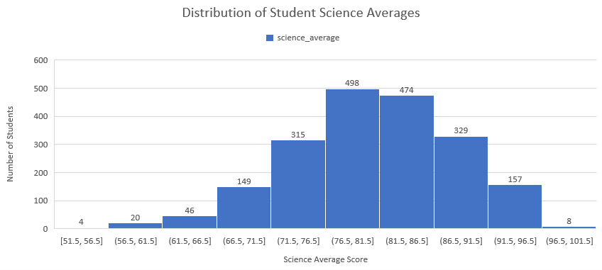
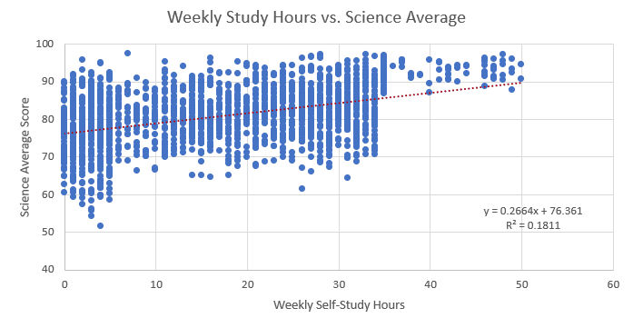
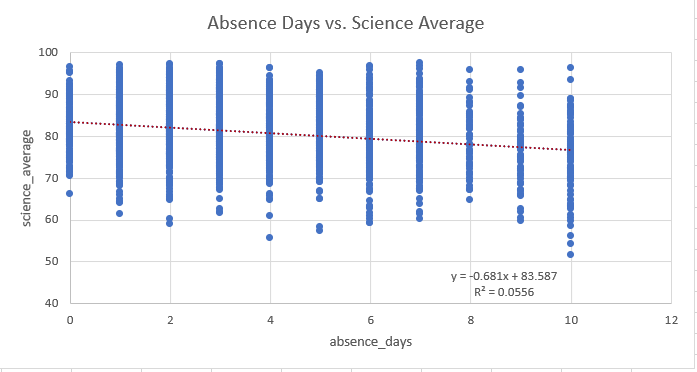
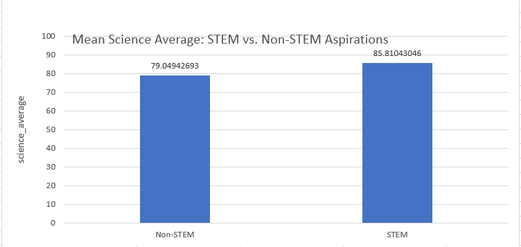
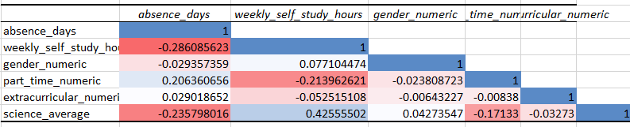

# Student Science Performance Analysis

## Statistical Analysis of Student Performance

This project investigates whether personal characteristics and study habits can predict students' Science Average.

The analysis was conducted using a dataset of 6,000 students and includes data cleaning, descriptive statistics, exploratory data analysis (EDA), hypothesis testing, and multiple linear regression.


Section 2: Research Question & Hypotheses
## Research Question

**Can personal characteristics and study habits predict students' Science Average?**

## Hypotheses

### Hypothesis 1 - STEM Career Aspiration

- **H₀:** Students aspiring to STEM careers have the same average Science Average as students aspiring to non-STEM careers.
- **H₁:** Students aspiring to STEM careers have a different average Science Average than students aspiring to non-STEM careers.

A Welch's independent samples t-test was used to compare the mean Science Average between the two groups.

### Hypothesis 2 - Multiple Linear Regression

The multiple linear regression analysis investigates whether personal characteristics and study habits collectively predict students' Science Average.

The independent variables included:

- Absence Days
- Weekly Self-Study Hours
- Gender
- Part-Time Job
- Extracurricular Activities

The dependent variable was **Science Average**.


Section 3: Project Overview & Workflow
## Project Overview

The project follows a structured statistical analysis workflow, starting with the original student dataset and progressing through data preparation, descriptive analysis, exploratory analysis, hypothesis testing, and predictive modeling.

### Analysis Workflow

1. **Data Collection** - Started with a dataset containing information on 6,000 students, including academic scores, study habits, personal characteristics, and career aspirations.
2. **Data Cleaning** - Reviewed the dataset, removed duplicate records and unnecessary columns, and created variables required for the analysis.
3. **Descriptive Statistics** - Examined the center and spread of key numerical variables using measures such as mean, median, standard deviation, quartiles, IQR, minimum, and maximum.
4. **Group Summary** - Compared Science Average and study hours across categorical groups such as gender, part-time employment, extracurricular activities, and career aspiration.
5. **Exploratory Data Analysis** - Used histograms, scatter plots, trendlines, and a correlation matrix to explore distributions and relationships between variables.
6. **Hypothesis Testing** - Used Welch's independent samples t-test to investigate whether students aspiring to STEM careers had a different average Science Average from students aspiring to non-STEM careers.
7. **Multiple Linear Regression** - Built a multiple linear regression model to examine whether personal characteristics and study habits collectively predict Science Average.
8. **Model Diagnostics** - Evaluated the regression model using residual analysis, a normal probability plot, and Variance Inflation Factor (VIF) to assess multicollinearity.


Section 4: Dataset
## Dataset

The analysis uses the **Studies Career Recommendation Dataset**, containing information on 6,000 students. The dataset includes academic performance, study habits, personal characteristics, and career aspirations.

### Main Variables Used

| Variable | Description |
|---|---|
| `gender` | Student gender |
| `part_time_job` | Whether the student has a part-time job |
| `absence_days` | Number of days the student was absent |
| `extracurricular_activities` | Whether the student participates in extracurricular activities |
| `weekly_self_study_hours` | Weekly hours spent on self-study |
| `career_aspiration` | Student's intended career category |
| `math_score` | Mathematics score |
| `history_score` | History score |
| `physics_score` | Physics score |
| `chemistry_score` | Chemistry score |
| `biology_score` | Biology score |
| `english_score` | English score |
| `geography_score` | Geography score |

### Target Variable

A new **Science Average** variable was created from the science-related academic scores in the dataset and used as the dependent variable throughout the analysis.

### Data Source

The original dataset was obtained from Kaggle:

**Studies Career Recommendation Dataset - Shanim Mahir**

The public dataset included in this repository is a sanitized copy from which direct personal identifiers such as first name, last name, and email address have been removed.


Section 5: Data Preparation & Cleaning
## Data Preparation & Cleaning

The original dataset was reviewed and prepared before performing the statistical analysis. The main goal of this step was to create a consistent dataset containing only the variables relevant to the research question.

### Cleaning Steps

- Removed duplicate records to avoid counting the same student more than once.
- Removed columns that were not relevant to the statistical analysis.
- Kept the personal characteristics, study habits, career aspiration, and academic score variables required for the analysis.
- Created a new `science_average` variable by calculating the average of the following science-related scores:

  - `math_score`
  - `physics_score`
  - `chemistry_score`
  - `biology_score`

- Created a STEM/non-STEM career aspiration classification from the `career_aspiration` variable for the hypothesis testing and group comparisons.
- Reviewed the resulting variables and their distributions before proceeding with statistical analysis.

The cleaned and prepared data was then used for descriptive statistics, exploratory data analysis, hypothesis testing, and multiple linear regression.


Section 6: Descriptive Statistics
## Descriptive Statistics

Descriptive statistics were used to understand the main characteristics of the dataset before performing more complex statistical analyses.

### Numerical Variables

The main numerical variables analyzed were:

- `absence_days`
- `weekly_self_study_hours`
- `science_average`

For each variable, the following measures were calculated:

- Mean
- Median
- Standard Deviation
- Minimum
- Maximum
- First Quartile (Q1)
- Third Quartile (Q3)
- Interquartile Range (IQR)
- Lower Fence
- Upper Fence

These measures were used to understand the **center and spread** of the variables and to identify possible extreme observations before continuing with the analysis.

### Categorical Variables

Categorical variables were summarized using Pivot Tables:

- Gender
- Part-Time Job
- Extracurricular Activities
- Career Aspiration (STEM / Non-STEM)

For each group, the number and percentage of students were calculated. Group-level summaries were also used to compare:

- Mean Science Average
- Mean Weekly Self-Study Hours
- Standard Deviation of Science Average
- Standard Deviation of Weekly Self-Study Hours

These comparisons provided an initial understanding of how student characteristics and study habits differed across groups.


Section 7: Exploratory Data Analysis
## Exploratory Data Analysis (EDA)

Exploratory Data Analysis was performed to better understand the distribution of Science Average and investigate relationships between the independent variables and the target variable before building the regression model.

### Science Average Distribution

The distribution of Science Average was examined using a histogram. Most students' Science Average values were concentrated around the center of the distribution, while relatively fewer students had very low or very high values.



### Weekly Self-Study Hours vs. Science Average

A scatter plot with a trendline was used to examine the relationship between weekly self-study hours and Science Average.

The plot showed a positive relationship: students who reported more weekly self-study hours tended to have higher Science Average values. The trendline and R² value were included to describe the strength of the relationship.



### Absence Days vs. Science Average

A scatter plot with a trendline was used to examine the relationship between absence days and Science Average.

The plot showed a negative relationship: students with more absence days tended to have lower Science Average values.



### STEM vs. Non-STEM Career Aspirations

The mean Science Average was compared between students aspiring to STEM and Non-STEM careers.

Students aspiring to STEM careers had a higher mean Science Average than students aspiring to Non-STEM careers. This comparison provided an initial indication of a difference between the two groups, which was examined more formally using Welch's t-test.



### Correlation Analysis

A correlation matrix was created to examine the linear relationships between the numerical variables included in the analysis.

The results showed a positive correlation between Weekly Self-Study Hours and Science Average, while Absence Days showed a negative correlation with Science Average. The remaining relationships were generally weaker.




Section 8: Hypothesis Testing
## Hypothesis Testing

To investigate whether students aspiring to STEM careers had a different average Science Average from students aspiring to Non-STEM careers, an independent samples Welch's t-test was performed.

### Hypotheses

- **H₀:** Students aspiring to STEM careers have the same average Science Average as students aspiring to Non-STEM careers.
- **H₁:** Students aspiring to STEM careers have a different average Science Average from students aspiring to Non-STEM careers.

### Results

| Group | Mean Science Average |
|---|---:|
| STEM | 85.81 |
| Non-STEM | 79.04 |

The Welch's t-test produced a **p-value of 1.93 × 10⁻⁹⁰**.

Since the p-value is far below the significance level of 0.05, the null hypothesis was rejected.

### Conclusion

There is statistically significant evidence that the mean Science Average differs between students aspiring to STEM and Non-STEM careers. In this dataset, students aspiring to STEM careers had the higher mean Science Average.

The test establishes a statistically significant difference between the two groups, but it does not by itself establish a causal relationship between career aspiration and Science Average.


Section 9: Multiple Linear Regression
## Multiple Linear Regression

A multiple linear regression model was developed to investigate whether personal characteristics and study habits collectively predict students' Science Average.

### Model

The dependent variable was:

**Science Average**

The independent variables were:

- `absence_days`
- `weekly_self_study_hours`
- `gender`
- `part_time_job`
- `extracurricular_activities`

The regression model estimates the expected Science Average based on the combined values of these five independent variables.

### Regression Results

The model produced the following overall results:

| Metric | Result |
|---|---:|
| Multiple R | 0.447 |
| R² | 0.200 |
| Adjusted R² | 0.198 |
| Standard Error | 6.802 |
| Observations | 2,000 |
| Significance F | 8.40 × 10⁻⁹⁴ |

The **R² of approximately 0.20** indicates that about 20% of the variation in students' Science Average is explained collectively by the five independent variables included in the model.

The Adjusted R² of approximately 0.198 is very close to the R² value, suggesting that the model's explanatory power remains similar after accounting for the number of predictors included.

The model's standard error was approximately 6.80 points, representing the typical size of the prediction error around the regression model.


Section 9.1: Regression Coefficients
### Regression Coefficients

The regression coefficients show how the predicted Science Average changes when each independent variable increases by one unit, while the other variables in the model are held constant.

| Variable | Coefficient | P-value | Interpretation |
|---|---:|---:|---|
| Absence Days | -0.328 | < 0.001 | Each additional absence day is associated with approximately 0.33 fewer points in predicted Science Average, holding the other variables constant. |
| Weekly Self-Study Hours | 0.236 | < 0.001 | Each additional weekly self-study hour is associated with approximately 0.24 additional points in predicted Science Average, holding the other variables constant. |
| Gender | 0.131 | 0.668 | The coefficient is small and not statistically significant, so there is insufficient evidence of an association between the coded gender variable and Science Average after accounting for the other predictors. |
| Part-Time Job | -1.395 | 0.001 | The coded part-time job variable is associated with approximately 1.40 fewer points in predicted Science Average, holding the other variables constant. |
| Extracurricular Activities | -0.191 | 0.614 | The coefficient is not statistically significant, so there is insufficient evidence of an association between the coded extracurricular-activity variable and Science Average after accounting for the other predictors. |

The regression results indicate that **Absence Days, Weekly Self-Study Hours, and Part-Time Job were statistically significant predictors at the 5% significance level**, while Gender and Extracurricular Activities were not statistically significant predictors.


Section 9.2: ANOVA and Overall Model Significance
### Overall Model Significance

An ANOVA test was used to determine whether the regression model as a whole provides statistically significant predictive information about Science Average.

The regression produced an **F-statistic of 99.45** with a **Significance F of 8.40 × 10⁻⁹⁴**.

Because the Significance F is far below the 0.05 significance level, the null hypothesis that all regression coefficients are simultaneously equal to zero was rejected.

This indicates that the set of independent variables, considered together, provides statistically significant information for predicting students' Science Average.

However, statistical significance of the overall model does not mean that the model explains most of the variation in Science Average. The R² of approximately 20% indicates that a substantial proportion of the variation remains unexplained by the variables included in this model.


Section 9.3: Model Diagnostics
### Model Diagnostics

Several diagnostic checks were performed to evaluate the reliability of the multiple linear regression model.

#### Multicollinearity — VIF

Variance Inflation Factor (VIF) was calculated for each independent variable to check for multicollinearity, which occurs when independent variables are strongly related to one another.

| Variable | VIF |
|---|---:|
| Extracurricular Activities | 1.004 |
| Part-Time Job | 1.074 |
| Gender | 1.006 |
| Weekly Self-Study Hours | 1.128 |
| Absence Days | 1.116 |

All VIF values were very close to 1, indicating that there was no meaningful multicollinearity among the independent variables included in the model.

#### Normal Probability Plot

A Normal Probability Plot was used to assess the distribution of the Science Average values.

The observations followed a generally smooth pattern, with some deviations toward the tails. This provided a visual check of the distribution before interpreting the regression results.

#### Residual Analysis

Residual analysis was also performed to examine the differences between the observed Science Average values and the values predicted by the regression model.

The residual plots were used as diagnostic tools to assess whether there were systematic patterns in the prediction errors and to evaluate the overall behavior of the model.


Section 10: Key Findings
## Key Findings

The analysis produced several important findings regarding student Science Average:

- **Study habits:** Weekly Self-Study Hours showed a significant positive relationship with Science Average. Students who reported more weekly self-study hours tended to have higher Science Average values.

- **Absence:** Absence Days showed a significant negative relationship with Science Average. Students with more absence days tended to have lower Science Average values.

- **Part-Time Job:** The part-time job variable was a statistically significant predictor in the multiple linear regression model and had a negative coefficient.

- **Gender:** Gender was not a statistically significant predictor of Science Average in the multiple linear regression model.

- **Extracurricular Activities:** Extracurricular Activities were not a statistically significant predictor of Science Average in the multiple linear regression model.

- **STEM Career Aspiration:** The Welch's t-test found a statistically significant difference in mean Science Average between students aspiring to STEM and Non-STEM careers. STEM students had the higher mean Science Average.

- **Overall Regression Model:** The multiple linear regression model was statistically significant and explained approximately 20% of the variation in Science Average.

- **Multicollinearity:** All VIF values were close to 1, indicating no meaningful multicollinearity among the independent variables.

Overall, the results suggest that study habits and attendance-related factors were important predictors of Science Average in this dataset, while some personal characteristics did not provide statistically significant predictive information after accounting for the other variables in the model.


Section 11: Tools & Techniques
## Tools & Techniques

The project was completed using the following tools and statistical techniques:

### Tools

- **Microsoft Excel**
- **Excel Analysis ToolPak**
- **Pivot Tables**
- **GitHub**

### Statistical Techniques

- Descriptive Statistics
- Data Cleaning
- Exploratory Data Analysis (EDA)
- Correlation Analysis
- Trendline Analysis
- Welch's Independent Samples t-test
- Multiple Linear Regression
- ANOVA / F-test
- Residual Analysis
- Variance Inflation Factor (VIF)
- Normal Probability Plot


Repository Structure
## Repository Structure

```text
student-science-performance-analysis/
|
--- analysis/
|   -- Student_Science_Performance_Analysis.xlsx
|   -- Student_Science_Performance_Presentation.pdf
|
--- data/
|   -- sanitized_student_scores_6k.csv
|
--- docs/
|
--- images/
|   -- science_average_distribution.png
|   -- study_hours_vs_science_average.png
|   -- absence_days_vs_science_average.png
|   -- stem_vs_nonstem_science_average.png
|   -- correlation_matrix.png
|
--- README.md


### Folder Description

analysis/ - Contains the complete Excel analysis workbook and final presentation.
data/ - Contains the sanitized version of the original dataset used for the project.
images/ - Contains selected visualizations used to present the analysis.
docs/ - Reserved for additional project documentation.
README.md - Provides an overview of the project, methodology, results, and conclusions.


Section 13: Limitations
## Limitations

Several limitations should be considered when interpreting the results of this analysis:

- The analysis is based on observational data, so the statistical relationships identified in the model should not be interpreted as causal effects.
- The multiple linear regression model explains approximately 20% of the variation in Science Average, meaning that a substantial proportion of the variation is related to factors not included in the model.
- The analysis uses a limited set of personal characteristics and study-habit variables. Other factors, such as teaching quality, socioeconomic background, access to educational resources, motivation, or learning environment, may also contribute to student performance but were not included in the model.
- Some categorical variables were represented using binary numerical coding for the statistical analysis, so their regression coefficients depend on the coding used.
- The results describe relationships within this dataset and may not necessarily generalize to other student populations or educational settings.


Section 14: Dataset Source & License
## Dataset Source & License

The original dataset was obtained from Kaggle:

**Studies Career Recommendation Dataset**  
Created by **Shanim Mahir**

[View the original dataset on Kaggle](https://www.kaggle.com/datasets/shanimmahir/studies-career-recommendation-dataset)

The original dataset is listed under the **Apache 2.0 license**.

The dataset used in this repository has been sanitized for public use by removing direct personal identifiers, including:

- `first_name`
- `last_name`
- `email`

The original dataset remains unchanged inside the analysis workbook to document the starting point of the analysis. The sanitized CSV in the `data/` folder is the version intended for public access.